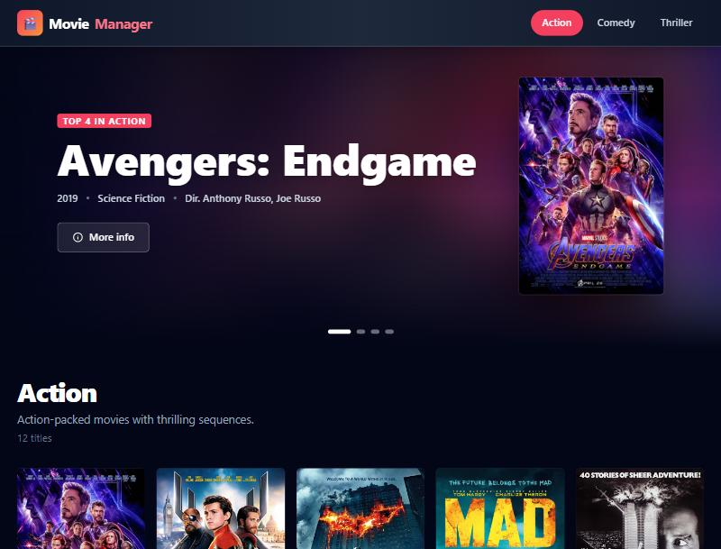
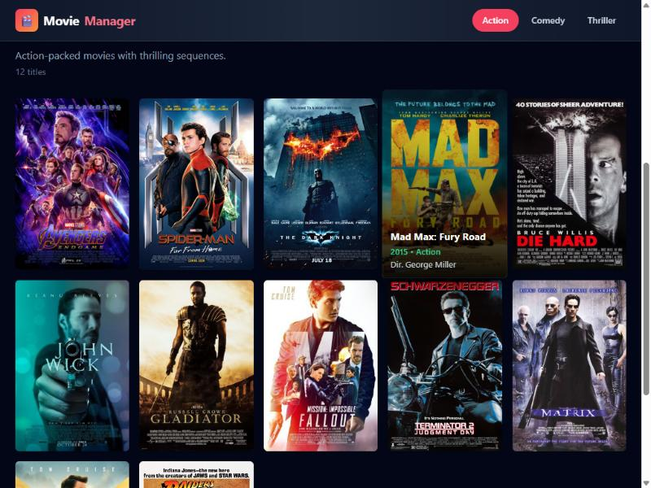
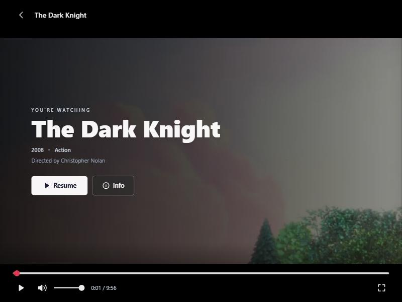
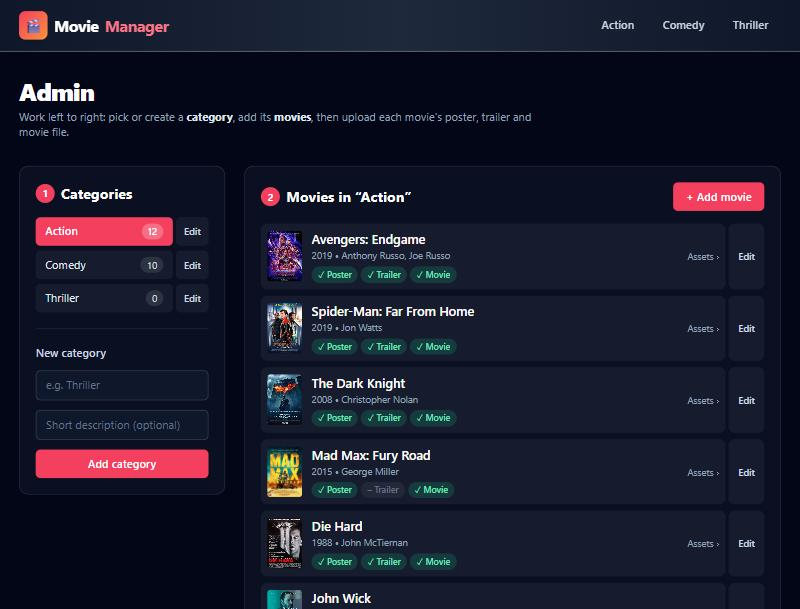
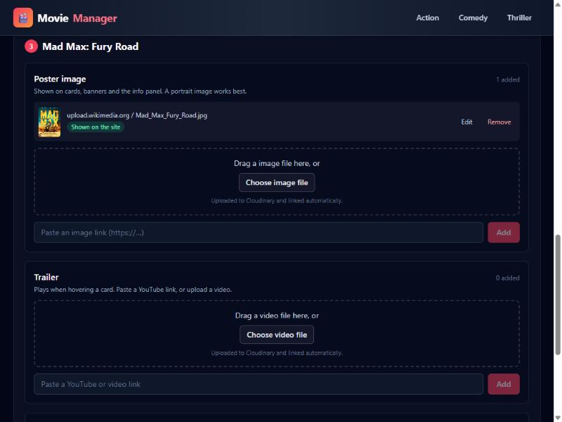
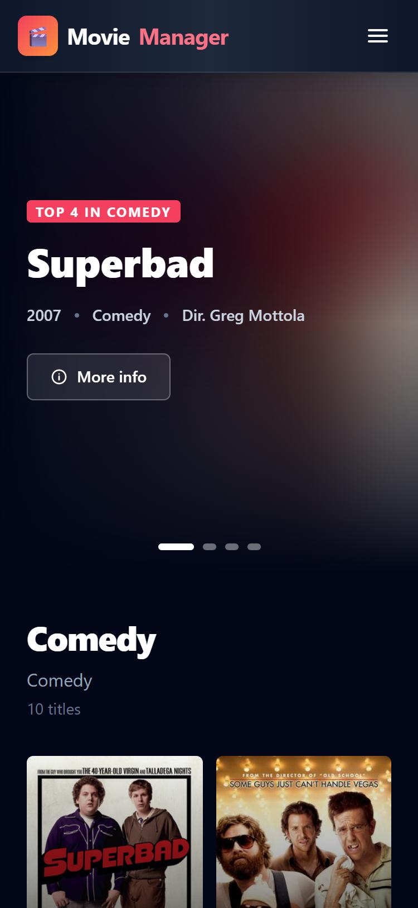
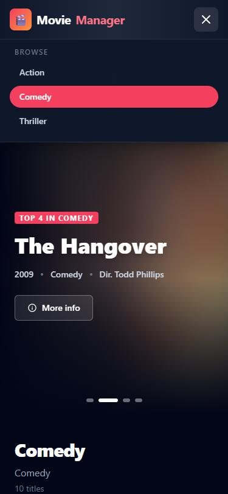
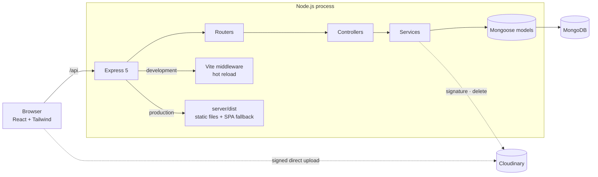
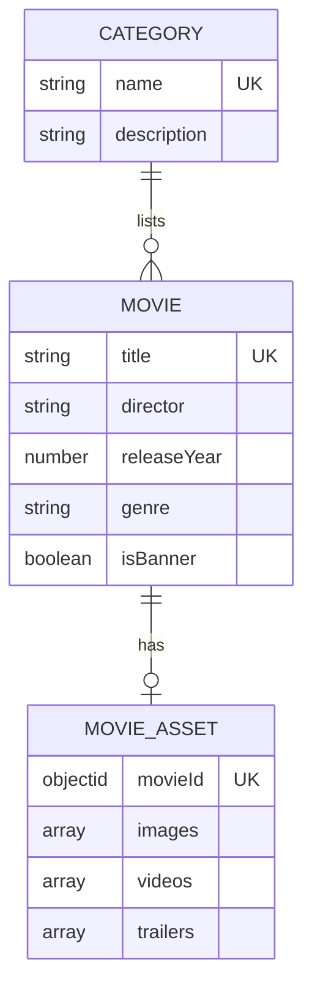
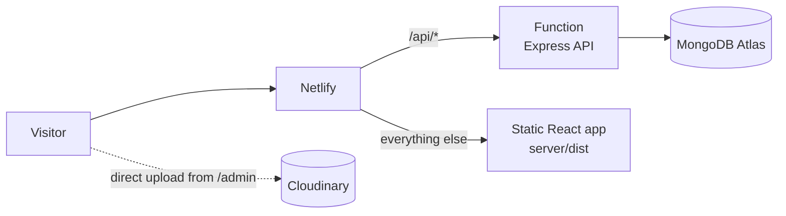

<div align="center">

# 🎬 MovieFlix

### A Netflix-style streaming experience with a full admin studio, built on one Node.js server.

Browse by category, preview trailers on hover, watch full-screen with a pause-to-reveal info screen, and manage every movie, poster, trailer and video file from a single friendly admin page.

[](https://nodejs.org)
[](https://expressjs.com)
[](https://react.dev)
[](https://vite.dev)
[](https://tailwindcss.com)
[](https://mongoosejs.com)
[](https://cloudinary.com)

<br />



</div>

---

## ✨ Why you'll like it

| | |
|---|---|
| 🎞️ **Netflix-style browsing** | Every category gets a "Top 4" hero carousel and a poster grid. Cards zoom on hover and play the trailer right inside the poster. |
| ▶️ **A proper watch page** | Full-screen, starts automatically, custom controls that fade away while you watch. **Pause** and the title, details and an **Info** button appear, exactly like the big streaming apps. |
| 🛠️ **One-page admin studio** | Create categories, add movies, then drag in posters, trailers and the movie file. Uploads go straight to Cloudinary with a progress bar. Edit or remove anything later. |
| 📱 **Responsive everywhere** | The menu is built from your categories and collapses into a hamburger on phones. |
| ⚡ **Vite inside Node** | One `npm install`, one command. Express serves the API **and** runs Vite as middleware, so you get hot reload in development and a static build in production. |
| 🧱 **Clean, modular backend** | Routers → controllers → services → models, with central error handling and validation. |
| ☁️ **Netlify-ready** | The React app deploys as static files and the Express API runs as a single serverless function. One `netlify.toml` configures it all. |

## 📸 Screenshots

<table>
  <tr>
    <td width="50%"><br /><sub><b>Hover a card</b> to zoom it, see the details, and preview the trailer.</sub></td>
    <td width="50%"><br /><sub><b>Pause the movie</b> and the info screen appears. It is hidden while playing.</sub></td>
  </tr>
  <tr>
    <td><br /><sub><b>Admin:</b> categories on the left, movies in the middle, with at-a-glance status for poster, trailer and movie file.</sub></td>
    <td><br /><sub><b>Assets:</b> drag a file in or paste a link. Edit, reorder or remove any item.</sub></td>
  </tr>
</table>

<div align="center">
<table>
  <tr>
    <td align="center"><br /><sub><b>Mobile</b></sub></td>
    <td align="center"><br /><sub><b>Menu from your categories</b></sub></td>
  </tr>
</table>
</div>

## 🧰 Tech stack

| Layer | Technology |
|---|---|
| **Frontend** | React 18, React Router 7, Tailwind CSS 3, plain `fetch` (no HTTP library) |
| **Build / dev** | Vite 5, run **inside the Express process** as middleware |
| **Backend** | Node.js, Express 5, Multer |
| **Database** | MongoDB with Mongoose 9 |
| **Media** | Cloudinary (signed, direct browser uploads) |
| **Hosting** | Netlify: static site + one serverless function |
| **Dev tools** | nodemon, a ready-made [`request.http`](server/request.http) for every endpoint |

## 🚀 Quick start

**You need:** [Node.js 20.12+](https://nodejs.org), a running [MongoDB](https://www.mongodb.com/try/download/community) (local or [Atlas](https://www.mongodb.com/atlas)), and, only if you want admin uploads, a free [Cloudinary](https://cloudinary.com) account.

```bash
# 1. Get the code
git clone https://github.com/DevShibz/movie_flix.git
cd movie_flix/server

# 2. Install (this one install covers the server AND the React client)
npm install

# 3. Configure
cp .env.example .env        # Windows PowerShell: Copy-Item .env.example .env
#    then open .env and fill in your values (see the table below)

# 4. Run
npm run dev
```

Open **http://localhost:3000**. The home page opens on the **Action** category. Visit **/admin** for the admin studio.

> Cloudinary keys are only needed for uploading files in the admin. Browsing, watching, and adding assets by link all work without them.

### Configuration (`server/.env`)

| Variable | Default | Description |
|---|---|---|
| `PORT` | `3000` | Port the server listens on |
| `MONGO_URI` | `mongodb://localhost:27017/movies` | MongoDB connection string |
| `CLOUDINARY_CLOUD_NAME` | | Your Cloudinary cloud name |
| `CLOUDINARY_API_KEY` | | Cloudinary API key |
| `CLOUDINARY_API_SECRET` | | Cloudinary API secret. Stays on the server and is never sent to the browser. |

### Scripts (run inside `server/`)

| Command | What it does |
|---|---|
| `npm run dev` | Start Express with Vite middleware and hot reload (nodemon restarts the server on backend changes) |
| `npm run build` | Build the React app into `server/dist` |
| `npm start` | Run in production mode, serving the built app from `server/dist` (run `build` first) |

## 🏗️ How it works

### One process, two modes



- **Development:** Express creates a Vite dev server in *middleware mode*, so the page, the hot-reloaded React modules and the API all come from the same port.
- **Production:** `vite build` outputs to `server/dist`, and Express serves it with a single-page-app fallback.
- **API vs. pages:** a request that asks for JSON but matches no route gets a real JSON `404`, while page navigations fall through to the React app.

### Project structure

```text
movie_flix/
├── netlify.toml                 # Netlify build, redirects and function settings
├── client/                      # React source (served and built by Vite from the server)
│   ├── index.html
│   ├── tailwind.config.js
│   ├── public/
│   └── src/
│       ├── pages/               # MoviesByCategory · MovieDetail (watch page) · Admin · NotFound
│       ├── components/          # header · banner · MovieCard · TrailerPreview · Toast · Spinner
│       │   └── admin/           # CategoryPanel · MoviePanel · AssetEditor
│       ├── hooks/useApi.js      # one hook for every request: loading, errors, toasts
│       └── lib/                 # fetch wrapper · Cloudinary upload helper
└── server/
    ├── index.js                 # starts the server
    ├── app.js                   # Express app = API + React app (Vite in dev, built files in prod)
    ├── api.js                   # the JSON API on its own (also used by the Netlify Function)
    ├── netlify/functions/api.js # wraps the API as a Netlify Function
    ├── vite.config.js           # Vite + Tailwind setup (root = ../client)
    ├── config/                  # environment + Cloudinary setup
    ├── router/                  # movies · categories · assets
    ├── controllers/             # thin request handlers
    ├── services/                # business logic and database/Cloudinary calls
    ├── models/                  # Movie · Category · MovieAsset
    ├── middleware/              # error handler · validation · uploads · frontend
    └── request.http             # every endpoint, ready to click in VS Code
```

### Data model



The **first** item in `images`, `videos` and `trailers` is the one the site shows. In the admin you can pick which with **Make primary**.

## 🛠️ The admin studio

Open **`/admin`**. It is intentionally not linked from the site menu.

1. **Categories:** create one (or rename it). The site menu updates instantly.
2. **Movies:** add a movie to the selected category, edit its details, add an existing movie, or remove it from the category.
3. **Assets:** for each movie, add a **poster**, **trailer** and the **movie file**, by dragging in a file or pasting a link. Files upload directly to Cloudinary with a progress bar and cancel button, and the URL is saved to the movie automatically.

> ⚠️ **There is no login yet.** Anyone who knows the `/admin` URL can change your data. Put it behind authentication before deploying anywhere public.

## ⌨️ Player shortcuts

| Key | Action |
|---|---|
| `Space` / `K` | Play / pause |
| `←` / `→` | Back / forward 10 seconds |
| `M` | Mute / unmute |
| `F` | Fullscreen |
| `Esc` | Close the info panel or trailer |

## ☁️ Deploy to Netlify

MovieFlix deploys as a **static React site** plus **one serverless function** that runs the Express API. Everything is configured in [`netlify.toml`](netlify.toml), so there is nothing to set up by hand except your environment variables.



### 1. Create a free MongoDB Atlas database

1. Create a cluster on [MongoDB Atlas](https://www.mongodb.com/atlas) and a database user.
2. Copy the connection string (`mongodb+srv://…`) and add a database name, for example `…mongodb.net/movies`.
3. Under **Network Access**, allow access from anywhere (`0.0.0.0/0`). Netlify functions don't have fixed IP addresses.

### 2. Create the Netlify site

1. Push this repository to GitHub.
2. In Netlify choose **Add new site → Import an existing project** and pick the repo.
3. Leave the build settings as detected. They are read from `netlify.toml`: base directory `server`, build command `npm run build`, publish directory `dist`.

### 3. Add environment variables

In **Site configuration → Environment variables**, add:

| Variable | Required | Value |
|---|---|---|
| `MONGO_URI` | Yes | Your Atlas connection string |
| `CLOUDINARY_CLOUD_NAME` | For uploads | From your Cloudinary dashboard |
| `CLOUDINARY_API_KEY` | For uploads | From your Cloudinary dashboard |
| `CLOUDINARY_API_SECRET` | For uploads | From your Cloudinary dashboard |

### 4. Deploy

Trigger a deploy (it starts automatically after step 2). When it finishes, open your site and visit `/admin` to add your first category and movies.

<details>
<summary><b>Prefer the command line?</b></summary>

```bash
npm install -g netlify-cli
netlify login
netlify init                 # run from the repository root; links the repo to a new site
netlify deploy --build --prod
```

Add the environment variables first (`netlify env:set MONGO_URI "…"`) or in the dashboard.

</details>

### Good to know

- **How requests are routed:** `/api/*` goes to the function, every other path serves the React app, with a fallback to `index.html` so `/movies/action`, `/movie/<id>` and `/admin` work on refresh.
- **Large uploads are fine.** The admin uploads files **directly from the browser to Cloudinary**, so big videos never pass through the function. The server-side `/api/assets/uploadAsset` route is only for small images, because Netlify limits a function request to about 6 MB.
- **Cold starts:** the first request after a quiet period can take a second or two while the function connects to MongoDB. Later requests reuse the connection.
- **Protect `/admin`** before sharing the URL. It has no login yet (see [the admin studio](#️-the-admin-studio)).
- **Local development is unchanged:** `npm run dev` still runs Express with Vite on `http://localhost:3000`.
- **API on another host?** Set `VITE_API_URL` (for example `https://api.example.com`) as a build variable and the React app will call that origin instead of `/api`.

## 🔌 API reference

All endpoints live under **`/api`**. All errors are returned as `{ "error": "message" }` with a meaningful status code (`400` validation, `404` not found, `409` duplicate, `413` file too large, `5xx` server). A ready-to-run collection of every request lives in [`server/request.http`](server/request.http) (use the VS Code [REST Client](https://marketplace.visualstudio.com/items?itemName=humao.rest-client) extension).

### Movies

| Method | Endpoint | Description |
|---|---|---|
| `GET` | `/api/movies` | All movies with their assets |
| `POST` | `/api/movies` | Create a movie: `title`, `director`, `releaseYear`, `genre`, optional `isBanner` |
| `GET` | `/api/movies/getBannerMovies` | Movies flagged as banners, with assets |
| `GET` | `/api/movies/detail/:movieId` | One movie with its images, videos and trailers |
| `PATCH` | `/api/movies/detail/:movieId` | Edit `title`, `director`, `releaseYear`, `genre`, `isBanner` |

### Categories

| Method | Endpoint | Description |
|---|---|---|
| `GET` | `/api/movies/categories` | All categories with their movies |
| `GET` | `/api/movies/categories/:name` | One category by name (case-insensitive) with movies and posters |
| `POST` | `/api/movies/addMovieCategory` | Create a category: `name`, `description` |
| `PATCH` | `/api/movies/categories/:categoryId` | Edit `name` and/or `description` |
| `POST` | `/api/movies/updateMoviesInCategory` | Add a movie to a category: `categoryId`, `movieId` |
| `POST` | `/api/movies/removeMovieFromCategory` | Remove a movie from a category (the movie is kept) |

### Assets

`type` is one of `images`, `videos` or `trailers`.

| Method | Endpoint | Description |
|---|---|---|
| `GET` | `/api/assets/movie/:movieId` | All assets of a movie |
| `POST` | `/api/assets/addAsset` | Add a URL: `movieId`, `type`, `url` |
| `POST` | `/api/assets/updateMovieAsset` | Replace a URL, keeping its position: `movieId`, `type`, `oldUrl`, `newUrl` |
| `POST` | `/api/assets/setPrimaryAsset` | Move a URL to the front: `movieId`, `type`, `url` |
| `POST` | `/api/assets/removeMovieAsset` | Remove a URL from a movie (does not delete the Cloudinary file) |
| `POST` | `/api/assets/uploadSignature` | Short-lived signature so the browser can upload straight to Cloudinary (the secret is never returned) |
| `POST` | `/api/assets/uploadAsset` | Server-side multipart upload (`file` field, max 10 MB) → `{ url, publicId }` |
| `POST` | `/api/assets/removeAsset` | Delete an uploaded image from Cloudinary by `publicId` |

## 🎞️ About the content

The screenshots use well-known films for demonstration only. Posters and trailers belong to their respective owners. Start from an empty database and add **your own** movies, posters, trailers and video files from the [admin studio](#️-the-admin-studio).

Trailers can be YouTube links (they play inside the poster cards) and the movie file can be any direct video URL or a file you upload to Cloudinary.

## 🗺️ Ideas for what's next

- Admin authentication and roles
- Delete endpoints and a trash/undo flow
- Search and filters
- User accounts, watchlists and "continue watching"
- Ratings and descriptions
- Tests and CI

## 🤝 Contributing

Issues and pull requests are welcome. Fork the repo, create a branch, make your change, and open a PR. Please keep the layered backend structure (router → controller → service) and run `npm run build` before submitting.

## 📄 License

Released under the ISC License.

<div align="center">
<br />

**If you like MovieFlix, give it a ⭐ — it really helps!**

</div>
